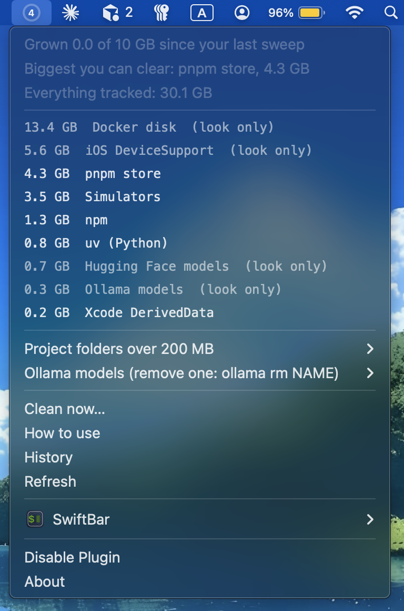
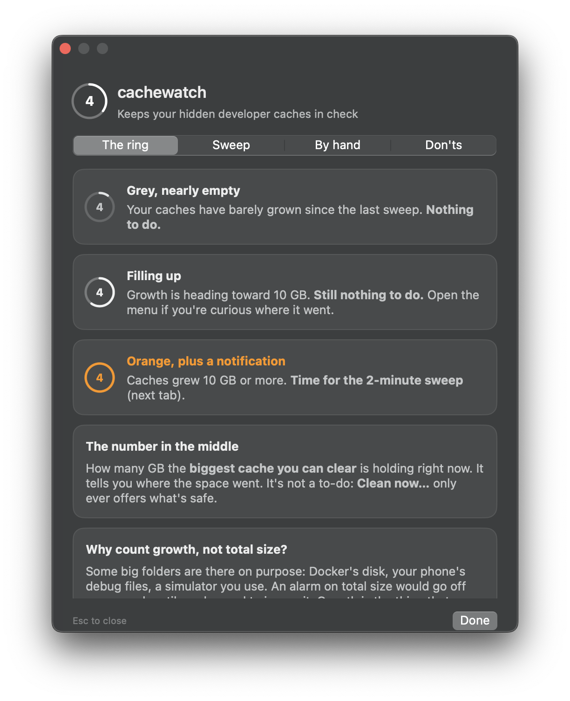

# cachewatch

**A small ring in your Mac's menu bar that tells you when the hidden developer caches have grown, and when a developer tool has been left running in the background, then helps you fix it safely when you say so.**

    

Every `npm install`, `uv sync`, Xcode build and model download leaves a copy behind so the next one is faster.
Nobody ever clears them, so they grow quietly forever. I found **61 GB** in a single Python cache I didn't know
existed. cachewatch keeps an eye on those folders for you.

- **The ring** fills up as your caches grow and turns **orange** once they've grown 10 GB since your last clean-up.
The number in the middle is how many GB your biggest clearable cache is holding.
- **Click it** to see every cache with its size, your biggest project folders, and your local AI models.
Click any row to see it in Finder.
- **Clean now…** walks through each cache in Terminal and asks **y/N** for every one, using that tool's own
clean-up command (`uv cache clean`, `npm cache clean`, `brew cleanup` …).
- **A weekly nudge** on Sunday mornings, only when there's actually something worth clearing.
- **A background check** that notices a simulator, Docker Desktop or a stuck tool left running and draining your
battery. It notifies you **once**, explains what it is and whether it's safe to quit, and offers a one-click fix.
- **How to use** opens a short guide right from the menu, so you never have to come back here.

## Install

```bash
git clone https://github.com/My-CMDhub/cachewatch.git && cd cachewatch && ./install.sh
```

The installer shows you exactly what it's about to do and waits for a **y** before touching anything.
It takes about a minute, and the ring shows up in your menu bar when it's done.

**One more click so it survives a restart:** click the ring → **SwiftBar** → **Preferences…** → tick **Launch at Login**.
(Only SwiftBar can switch that on, so the installer can't do it for you.)

### What the installer does, at a glance

| Step | Where | Why |
|---|---|---|
| Builds 2 small helpers from the Swift source in `src/` | `~/.local/bin/cachering`, `cacheguide` | One draws the ring picture, the other is the guide window. Built on your Mac so you can read every line first. |
| Copies the main script | `~/.local/bin/cachewatch` | Measures the cache folders and does the clean-up when you ask. |
| Adds a menu-bar plugin | `~/.config/swiftbar/cachewatch.5m.sh` | [SwiftBar](https://swiftbar.app) shows it as the ring. It glances at running programs every 5 minutes (cheap) and re-measures cache sizes every 6 hours (the slow part). |
| Schedules a weekly check | `~/Library/LaunchAgents/io.github.my-cmdhub.cachewatch.plist` | Runs on Sundays at 10:00 and notifies you only if your caches grew past your limit. |
| Creates a settings file | `~/.config/cachewatch/config.zsh` | Your alert size and project folders. Never overwritten on update. |
| Installs SwiftBar, *only if it's missing and you have Homebrew* | `/Applications/SwiftBar.app` | The free, open-source app that puts the ring in your menu bar. |

### What it never does

- **Never deletes anything on its own.** Caches are only cleared when you click *Clean now…* and answer **y** to each one.
- **Never touches the big personal stuff.** Docker's disk, AI models, phone debug files and your project folders are *look only*: it shows their size and tells you how to clear them yourself.
- **Never needs your password.** Everything installs in your own home folder; no `sudo`.
- **Never sends anything anywhere.** It only reads folder sizes on your Mac. No analytics, no network calls.

**Needs:** macOS 13 Ventura or newer, and Apple's Command Line Tools (if you don't have them, the installer tells you to run `xcode-select --install`).

## Using it


| The ring | What it means | What to do |
|---|---|---|
| Grey, nearly empty | Caches have barely grown since your last clean-up | Nothing |
| Filling up | Growth is heading toward your limit (10 GB by default) | Nothing yet |
| **Orange** + a notification | Caches grew past your limit | Click the ring, then **Clean now…** |

When you clean up, it's fine to say **yes** to the download caches (uv, pip, npm, pnpm, Yarn, Bun, Homebrew, CocoaPods, Go). The worst case is one install later takes a little longer.
Say **no** to Xcode DerivedData only while Xcode is in the middle of a build. After a clean-up, the ring empties and starts counting again.

### Background check

A **⚠︎ beside the ring** means something heavy has been left running. You get one notification about it, and it's
listed at the top of the menu in orange, with what it is, whether quitting it is safe, and a quick fix.

| It flags | When | Quick fix |
|---|---|---|
| An iOS simulator | On for 30 minutes or more. A forgotten one can hold your speakers open and stop your Mac from idling. | Shut it down (it boots again in seconds) |
| Docker Desktop | On for 30 minutes or more. Its Linux VM holds gigabytes of memory. | Quit Docker Desktop (running containers stop) |
| Any of your own programs | Above 50% CPU on two checks in a row. The app you're using right now is never flagged. | Quit it, after checking what it is |

Nothing is ever stopped for you. If you're using it, just ignore it; you won't hear about it again.
The quick fix only acts on the exact process it showed you, so a menu that's a few minutes old can't hit the wrong program.

## What it watches

| Cleared for you (after a y) | Look only (you decide) |
|---|---|
| uv, pip, npm, pnpm, Yarn, Bun, Homebrew, CocoaPods, Go build cache, Xcode DerivedData (moved to the Trash), unavailable simulators | Docker's disk, iOS DeviceSupport, Xcode Archives, Gradle, Cargo registry, Playwright browsers, Hugging Face / Ollama / LM Studio models, project `node_modules` and `.venv` folders |

Folders you don't have are simply skipped. A cache only shows up in *Clean now…* if its tool is installed and it's over 100 MB.

## Settings

Open `~/.config/cachewatch/config.zsh`:

```zsh
GROW_GB=10                                   # alert after this much growth
PROJECTS=($HOME/Developer $HOME/Projects)    # where your node_modules / .venv live
EXTRA_ITEMS=(                                # watch anything else: "Label|/folder|clean command"
  "Android system images|$HOME/Library/Android/sdk/system-images|"
)
SIZES_EVERY_H=6     # re-measure cache sizes this often
BG_CHECK=1          # 0 turns the background check off
CPU_HOG=50          # flag your own programs above this % CPU on two checks in a row
SIM_MIN=30          # flag a simulator or Docker Desktop left on longer than this (minutes)
BG_IGNORE=(node)    # program names never to flag
```

## From Terminal

```bash
cachewatch            # table of caches, biggest first
cachewatch --clean    # the clean-up, one y/N at a time
cachewatch --bg       # what's running in the background right now
cachewatch --help
```

## Update or uninstall

```bash
git pull && ./install.sh     # update: your settings stay as they are
./uninstall.sh               # remove: asks before deleting your settings and history
```

Uninstalling leaves your caches and SwiftBar alone.

## How it works

Everything talks in plain text. The script measures folders with `du` and prints its menu as lines of text.
SwiftBar turns those lines into the menu, and macOS's own scheduler (`launchd`) runs the weekly check.
Only two parts are native Swift, because only they draw pixels: `cachering` draws the ring and hands it over as text,
and `cacheguide` is the floating guide window. About 600 lines in all, with no dependencies beyond SwiftBar.

## FAQ

**Is it safe to clear these caches?** The ones it offers are download caches. Each is cleared with its own tool's
command, and the tool downloads anything it needs again later. Anything where a wrong guess could cost real data
(Docker volumes, models, your projects) is look only.

**Why a growth alert instead of a size limit?** Some big folders are there on purpose (Docker, a simulator you use).
An alarm on total size would go off every week until you ignored it. Growth is what sneaks up on you.

**Does it slow my Mac down?** The 5-minute check only reads the process list, which takes a fraction of a second.
Measuring cache sizes takes a few seconds, up to ~30 s if Docker's disk is large, and runs every 6 hours.

**A cache I use isn't listed.** Add it to `EXTRA_ITEMS` in your settings, or open an issue or PR so everyone gets it.

## Test

```bash
./test.sh   # runs against a fake home folder; your real caches are never touched
```

## Licence

MIT. See [LICENSE](LICENSE).
